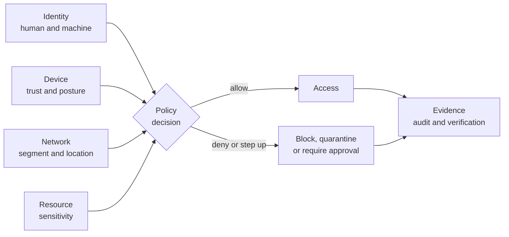

# CyberNorf

**One console for identity, device, network and evidence — a self-hosted, policy-driven security operations platform for teams that have to prove every decision.**

CyberNorf answers the questions a defender actually asks, in one tenant-isolated workspace: what do we own, what is wrong with it, who and what can reach it, was that access legitimate, what did we do about it, and can we prove it afterwards. It is built for small security teams that need enterprise-grade accountability without an enterprise-grade integration project.

> **Status:** Early-stage and not production-ready. The security-operations, endpoint-monitoring, identity-governance, controlled-execution and Zero Trust control-plane foundations are implemented and tested; the parts of Zero Trust that need a real network appliance — an 802.1X authenticator, a connector-callable decision point, verified hardware attestation and traffic analytics — are not. [Implementation status](#implementation-status) is the authoritative list, and it marks the six Zero Trust capabilities as one implemented and five partial with the exact gap named.

## The platform

The governing rule is that **nothing is trusted because it is inside the network.** Every access, deployment and enforcement decision is meant to be evaluated against an explicit policy, recorded as an attributable event, and verifiable afterwards. CyberNorf keeps observation, decision and outcome as separate records, so a detection, an inventory entry or a dashboard is never mistaken for proof.

That rule organises the platform into three layers:

- **Know** — who and what exists: human and non-human identities with owners and lifecycle, assets with criticality, devices with posture, network segments and the connections between them.
- **Decide** — whether a specific request should be allowed: policy evaluation against identity, role, resource sensitivity, device trust, network location, time, risk and approval state, with every decision explained and recorded.
- **Prove** — what happened: a hash-chained audit trail, evidence linked to controls, and outcomes the platform has verified rather than assumed.



## Capabilities

Each row describes what the capability is designed to do. The **Today** column states what exists in this repository; the roadmap is authoritative for everything else.

| Capability                           | What it does                                                                                                                                                                                                                            | Today       |
| ------------------------------------ | --------------------------------------------------------------------------------------------------------------------------------------------------------------------------------------------------------------------------------------- | ----------- |
| Tenant isolation and authorization   | Organizations with four roles, deny-by-default capabilities checked on the server for every route and page, TOTP for privileged mutations, optional OIDC sign-in, personal API keys for automation                                      | Implemented |
| Asset and exposure inventory         | Registered, owned, classified assets with type, criticality and lifecycle, shared by findings, incidents and compliance evidence                                                                                                        | Implemented |
| Vulnerability and finding management | Manual or JSON-imported findings with fingerprint deduplication, documented lifecycle, assignment, remediation notes, 0–100 risk score and severity-based SLA deadlines, with overdue and compliance reporting                          | Implemented |
| Incident and investigation workflow  | Investigations with ownership, severity, notes, linked findings and a forward-only lifecycle with resolution timestamps                                                                                                                 | Implemented |
| Compliance and control evidence      | Framework and control catalog, organization adoption, attestation, and evidence linked to real findings, incidents and assets                                                                                                           | Implemented |
| Evidence files and signed exports    | Files attached to controls with a SHA-256 digest and capture time, verified later, plus a signed portable package of the full organization export that an auditor can verify offline                                                    | Implemented |
| Controlled execution                 | Engagements with include/exclude scope over domains, IPs, CIDRs and URLs, separately approved and expiring authorizations, and four declarative probes dispatched to an operator-run worker; dispatch and start both re-evaluate scope and DNS, and high-risk jobs need a second reviewer | Implemented |
| Tenant data retention                | Four per-tenant windows (agent runs, alert deliveries, software inventory, finished execution jobs) with a preview of what would be deleted, an OWNER-only purge, and a cron sweep for saved policies                                          | Implemented |
| Endpoint monitoring                  | Owner-approved host agents submitting scheduled runs with host facts, baseline checks and package inventory; health from heartbeats, optional signed runs, advisory matching and signed alert webhooks                                  | Implemented |
| Identity lifecycle and inventory     | Human and non-human identities with canonical identifiers, criticality, accountable owner, approved scopes, credential expiry and rotation, approval status and revocation history                                                      | Implemented |
| Machine credentials                  | One scoped, expiring, hash-stored bearer credential per non-human identity, revocable immediately and narrowed automatically when approval shrinks                                                                                      | Implemented |
| Access reviews and recertification   | Campaigns that snapshot memberships, record an explicit retain or revoke decision per member, and apply revocations atomically with last-owner protection                                                                               | Implemented |
| Tamper-evident audit                 | Per-organization hash chain written in the same transaction as the change, append-only by database trigger, verifiable through the UI and API, plus a separate append-only authentication activity table                                | Implemented |
| Zero Trust policy decisions          | Ordered rules evaluated first-match, deny-by-default on no match, with a stored verdict carrying the server-resolved facts, risk factors, matched rule and explanation. Tenant API, not a connector-callable PDP (`policy.manage` to evaluate) | Partial     |
| Device trust and posture             | Ed25519 device keys, posture that must verify before it can raise trust, and trust derived from status, freshness, check results, management and attestation. Attestation is recorded, not verified, and posture arrives through `device.manage` | Partial     |
| Network access control               | Connectors with hashed tokens and heartbeats, CIDR segments with zones, and posture-gated admission whose zone comes from a stored segment and whose offline behaviour follows the connector's `CLOSED`/`OPEN` fail mode. No RADIUS or 802.1X authenticator | Partial     |
| Network visibility and detection     | Bounded flow ingestion from connectors, segment inventory, and five detections that store their supporting flows and a `freshUntil`. No packet capture, topology graph or TLS metadata     | Partial     |
| Enforcement and response actions     | Requested, separately approved and idempotent commands to registered connectors — session revocation, endpoint isolation, network quarantine, firewall blocking, certificate revocation — with connector acknowledgement and effect verification, requester/approver separation, and expiry for commands nobody acted on | Implemented |
| Secure update and certificate trust  | Manifest signatures verified against publisher keys held in the environment, artifact digests, compatibility and anti-rollback floors, staged canary rollout, per-device offers and install results, and rollback that stops offers. No hardware-bound identity, artifact serving or certificate authority | Partial     |
| Analytics and correlation            | Correlation across authentication, identity, device and network observations, configurable rules, anomaly scoring, prioritised investigations, and alerts that explain the observations behind them                                     | Partial     |
| Dashboards and reporting             | Risk trends, SLA compliance, agent health, posture summaries and drill-down timelines for the implemented workflows; network and enforcement dashboards to follow                                                                       | Partial     |

**What CyberNorf deliberately does not do.** It does not scan on its own initiative or expose an arbitrary command channel: active testing happens only inside an approved engagement and scope, as one of four declarative probes (`DNS_LOOKUP`, `HTTP_PROBE`, `TLS_INSPECTION`, `PORT_SCAN`) dispatched to a worker the operator runs. It is not an EDR, SIEM, vulnerability scanner or packet-analysis platform, it is not a NAC appliance — it records an admission decision and hands the outcome to a connector, and it does not terminate 802.1X — and it never intercepts or decrypts user HTTPS traffic. The only files it stores are control evidence you attach, on the operator's evidence volume with a SHA-256 digest. Suspending an identity record does not end a console session because membership remains the access control. Identity, agent, advisory and asset records are workflows over data you supply, not discovery engines.

## Core design principles

1. **Default deny:** sensitive actions are denied unless the required permission, scope, and approval checks pass.
2. **Least privilege:** users and services receive only the access they need.
3. **Authorization before testing:** active testing must be explicitly authorized and restricted to approved assets and time windows.
4. **Defense in depth:** enforce controls on the server and execution environment, not only in the UI.
5. **Privacy by design:** minimize collected data, isolate tenants, protect secrets, and define retention and deletion behavior.
6. **Accountability:** record security-relevant actions while protecting audit records from unauthorized alteration.
7. **Honest status:** document what is implemented, tested, planned, and known to be incomplete.

## Intended users and deployment

The initial focus is defensive security practitioners, SOC analysts, developers, and small security teams. More sensitive workflows should only be introduced after the authorization, isolation, logging, and incident-response controls are built and tested.

CyberNorf is self-hosted. The production stack runs one console container against one PostgreSQL database behind a TLS proxy, with migrations applied from the same image. See [the production deployment guide](docs/DEPLOYMENT.md) and [the local development guide](docs/DEVELOPMENT.md).

## Implementation status

**Phase 0, Phase 1, Phase 4 and Phase 6 are implemented, and parts of Phases 2, 3 and 5 ship** — endpoint monitoring and advisory matching, alert delivery, compliance evidence, dashboards, rate limits, health probes, tenant retention with a scheduled sweep, a restore drill, scoped execution, and a Zero Trust control plane of devices, policy decisions, network admission, enforcement and verified releases. Phase 6 is marked partial where its own description needs a network appliance or a device-facing channel; the table above names each gap. The application supports real multi-tenant workflows behind authenticated sessions, capability-based authorization, and a hash-chained audit trail. The remaining enterprise items in Phase 5 — SAML/SCIM, scheduled access reviews, an independent assessment and legal review — are not implemented; the [roadmap](ROADMAP.md) lists each gap per phase.

### Where the roadmap stands

The checklist is re-scanned rather than trusted: `grep -n '^- \[ \]' ROADMAP.md` lists every open item, and each one is then checked against the code. On 2026-11-13 that scan found **55 delivered items and 12 open**. The delta from the previous pass is Phase 6, which adds six delivered items and five named gaps; the count is taken from the file each time rather than carried forward. Each open item is open for a reason a code change alone cannot close:

- **Customer segment** — [ADR 0006](docs/decisions/0006-initial-customer-segment.md) is **Proposed** and needs design-partner feedback, not another document.
- **Secrets handling** — startup validation, mounted secret files (`SECRETS_DIR`), the assisted rotation command and the keyed configuration fingerprint ship; there is no secrets-manager client, rotation is not scheduled, and no rotation has been drilled against a real deployment.
- **API and tenant-isolation review** — the internal pass is complete and its one misbinding is fixed, but the reviewer is the author, so independence is outstanding.
- **SSO** — one OpenID Connect provider; no SAML, SCIM, directory sync, or automatic de-provisioning.
- **Administrative access reviews** — campaigns with per-item decisions and an assigned reviewer ship; scheduling, privileged-access campaigns and reviews of non-human credentials do not.
- **Zero Trust gaps** — no 802.1X/RADIUS authenticator or VLAN programming, no decision endpoint a connector can call with its own token, attestation recorded but not verified, five flow rules rather than traffic analytics, and updates that stop at offer-and-report with no artifact delivery or build rollback.
- **Independent security assessment** and **legal/privacy review** — external work, not repository work.

Delivered items are checked only when code, tests and documentation agree, and the [alignment notes](ROADMAP.md#alignment-notes) record what moved on each pass and why.

### What works today

- **Accounts:** email and password registration and sign-in (12-character minimum passwords), optional OpenID Connect single sign-on, eight-hour sliding sessions, sign-out, and TOTP enrollment with ten backup codes at `/account/security`. The account that creates an organization becomes its `OWNER`, and because owners and administrators are privileged, the server refuses their data changes until a second factor is enrolled. A banner on every organization page links to the enrollment screen, so enroll before adding the estate.
- **Organizations:** create an organization, switch between organizations you belong to, and manage members and roles. `OWNER` is an explicit superuser tier: every administrator capability plus five owner-only decisions — grant or revoke an `ADMIN` or `OWNER` membership, approve or revoke an engagement authorization, approve, suspend or revoke an agent, approve a non-human identity, and purge retained history. Those decisions still require a second factor, are still audited, and never cross a tenant boundary.
- **Identity governance:** inventory human and non-human identities with type, criticality, owner, and lifecycle status; register service accounts, monitoring agents, API clients, servers, network devices, IoT devices, and containers that start pending owner approval; issue, rotate, and revoke one scoped, expiring bearer credential per machine; and run membership access reviews whose retain/revoke decisions are recorded per member and finalize atomically ([details](docs/IDENTITY_GOVERNANCE.md)).
- **Assets:** register, edit, retire, and inspect organization-owned assets with type, identifier, criticality, and lifecycle status.
- **Findings:** create findings manually or import them as JSON, deduplicate by fingerprint, move them through the documented lifecycle, assign them, and record remediation. Every finding is scored 0–100 from severity, CVSS, and asset criticality, gets a remediation deadline from its severity, and can be filtered to just the overdue work; the dashboard reports SLA compliance and mean time to resolve ([details](docs/FINDINGS.md)).
- **Incidents:** create investigations, record notes, link findings, and move them through a forward-only lifecycle.
- **Endpoint monitoring:** enroll a host agent with a one-time token, approve it as an owner, and receive scheduled runs with host facts, baseline security checks and installed packages; optionally require signed runs, match packages against an imported advisory feed, and deliver alerts to webhook destinations with sealed signing secrets.
- **Compliance:** adopt a framework from the control catalog, attest controls, and attach evidence that links back to findings, incidents and assets.
- **Zero Trust control plane:** enrol devices with Ed25519 keys, submit a signed posture report whose trust is derived rather than assigned, write ordered policy rules and evaluate a request against the server-resolved facts to get a recorded, explained verdict, register network connectors and CIDR segments, ask for an admission decision whose zone comes from a segment and whose offline behaviour follows the connector's fail mode, request a disruptive action that a second person approves and a connector acknowledges, and publish a release whose manifest signature verifies before it can be offered to a device ([details](docs/decisions/0009-zero-trust-control-plane.md)).
- **Controlled execution:** define an engagement and its include/exclude scope, request an authorization that a second person approves with an expiry, register a worker with probe capabilities and an egress allowlist, and dispatch `DNS_LOOKUP`, `HTTP_PROBE`, `TLS_INSPECTION` or `PORT_SCAN`. Start re-checks the authorization and the live DNS answer, redirects are evaluated as new targets, and a high-risk job waits for review by someone other than its requester ([details](docs/decisions/0008-scoped-execution-and-evidence-packages.md)).
- **Evidence files:** attach a file to a control with its SHA-256 and the time it claims to have been captured, verify the bytes later, and issue a signed package that an auditor can verify offline.
- **Retention:** set per-category windows under _Settings → Retention_, preview what they would delete, purge as an OWNER, or let the `/api/cron/retention` timer apply every saved policy.
- **Audit:** every security-relevant action is written to a per-organization hash chain that the UI and API can verify. Authentication activity — sign-in success and failure, second-factor verification, session ending, and two-factor disablement — is recorded in a separate append-only table, because a sign-in happens before any organization is known, and is shown to the account it belongs to on `/account/security`.

### Security properties currently enforced

- Server-side deny-by-default capability checks on every tenant API route and every server-rendered tenant page; navigation only _reflects_ those capabilities.
- Organization scope resolved from membership, never from client input. Records from another organization resolve to `404`, not `403`.
- TOTP second factor required for `OWNER` and `ADMIN` accounts before they can modify tenant data.
- Same-origin check for state changes, per-IP and per-user rate limits shared through PostgreSQL, bounded JSON bodies, and uniform error responses without stack traces.
- `UPDATE` and `DELETE` on audit rows rejected by a database trigger, with per-organization advisory locking so concurrent writers cannot fork the hash chain. Authentication activity rows are append-only by their own trigger, and never store the address a failed sign-in typed.
- Machine credentials are stored only as SHA-256 digests, expire within a bounded TTL, carry one scope (`identity.self.read`), are limited to one active credential per identity, and are re-checked for revocation, scope, expiry, and identity status on every call. The plaintext token is shown once at issue time and never written to the database or audit trail.
- A device posture report raises trust only when its Ed25519 signature verifies over the canonical `{ deviceId, collectedAt, checks }`; an unsigned or transplanted report is stored as unverified and leaves the device `UNKNOWN`. Policy decisions store the facts they were evaluated against, deny when no rule matches, and a malformed rule denies instead of being skipped.
- Network admission is fail-closed when the connector that would enforce it is unreachable and configured `CLOSED`, and the recorded reason says so. Enforcement commands cannot be approved by their requester, the four disruptive kinds need a distinct second approver, a retried request returns the original action instead of sending a second command, and a command nobody acknowledged expires.
- Release manifests are verified against publisher public keys held in the environment, not the database, so a database compromise cannot mint a release the platform would accept; publishing under an unconfigured key id fails.

### Known limitations

- No password reset, email verification, or invitation email. An owner or administrator must add an already-registered account by email.
- SSO is a single OpenID Connect provider enabled through `OIDC_*` variables: no SAML, no SCIM, and no automatic de-provisioning when someone leaves the identity provider.
- Evidence files live on the local evidence volume (`EVIDENCE_DIR`), not object storage, so multiple app instances need shared storage; uploads are bounded by size and content type and count against the tenant's evidence-storage quota. Signed evidence packages answer `503` until `EVIDENCE_SIGNING_KEY` is configured.
- Identity governance has no SCIM, OIDC, or CSV import, so inventory must be entered manually and can drift from the directory. Suspending a human identity does not end an existing console session (that requires revoking the membership). Access reviews cover memberships only, are never scheduled automatically, cannot be reopened, and do not revoke machine credentials. Machine tokens are bearer secrets with no mTLS, workload attestation, IP allowlist, or per-request nonce.
- No background worker is bundled: a cron job or systemd timer calls the alert sweep and the retention sweep, and one-off exports and retention runs are scripts. Controlled execution needs a worker the operator runs and registers; this repository ships the registration and job API, not the worker runtime.
- The execution plane trusts the registered worker to honour the job contract — duration limit, cancellation and its declared egress allowlist. There is no shell, file-transfer or arbitrary-command capability, so the blast radius is the four declarative probes.
- Zero Trust stops at a recorded decision handed to a connector. There is no RADIUS or 802.1X authenticator, no EAP-TLS termination, no certificate authority and no switch programming, so VLAN assignment is an outcome the connector applies rather than something the platform configures.
- The decision point is a tenant API: `policies/evaluate` needs `policy.manage` and `network/admission` needs `network.manage`, so a gateway cannot ask with its own connector token, and a decision is point-in-time rather than re-evaluated when device trust later drops.
- Device attestation is recorded, not verified: `attestationKind` and `attestationVerified` gate `TRUSTED`, but no TPM or Secure Enclave quote is validated, and posture arrives through `device.manage` — the signature binds the content to the device, not the transport to the device.
- Detection is five rules over flow batches from connectors (`port_scan`, `quarantine_egress`, `ot_external_inbound`, `external_egress`, `bulk_transfer`) with the supporting flows and a `freshUntil` stored; there is no packet capture, deep inspection, TLS metadata, topology graph or learned baseline, and a detection is only as good as the connector that reported the flow.
- Updates stop at offer and report. The platform verifies manifests, stores digests, enforces compatibility and an anti-rollback floor, advances a staged rollout, and rolls back by stopping offers; it does not serve artifacts, compute deltas, sign artifacts themselves or revert an installed build, and install results come through `update.manage` rather than from the device.
- Nothing pages a human. `/api/ready` fails when the database is unreachable or its schema is behind the image, but alert routing is an operator responsibility, and recovery depends on running `npm run db:restore-drill` on a schedule and keeping the report.
- Application logs are JSON lines on stdout with no shipping, rotation, metrics, or tracing built in. There is no collector, dashboard, or log-based alerting; the host's log driver must bound disk use ([details](docs/LOGGING.md)).
- Secrets come from environment variables: there is no secrets-manager integration, no automated rotation, and no rotation drill has been executed against a real deployment. Startup validates every variable and the rotation runbook is documented ([details](docs/SECRETS.md)).
- The audit chain is hash-linked but not signed, and depends on restricting direct database access.
- Rate-limit counters are only removed when `data:retention` runs with `--prune-rate-limits`.
- Retention never removes findings, incidents, assets, compliance evidence, or audit rows; the policy covers agent runs, alert deliveries, software inventory and finished execution jobs, and a person closes the other records.
- The production stack targets one host: one console container against one PostgreSQL database, with no horizontal scaling or high availability.

Before any public or production release, still required: a restore drill run against a production-size copy on a schedule with its reports retained, a rehearsed `BETTER_AUTH_SECRET` rotation, alert routing to a human, and an independent security review of the API and tenant isolation. Backup tooling, retention workflows, deployment documentation and a local drill report exist; operating them on a schedule is the operator's job.

### Checks

```sh
npm test        # unit + database-backed integration tests (needs the test database)
npm run lint
npm run typecheck
npm run build

# Validates every environment variable; exits non-zero on a config the app would refuse.
npm run config:check -- --env-file .env.production

# Proves a dump restores and the restored copy still enforces its guarantees.
npm run db:restore-drill -- --docker-exec <database-container> --report drill.json
```

See [the local development guide](docs/DEVELOPMENT.md) for setup, test-database creation, and the demo walkthrough, [the production deployment guide](docs/DEPLOYMENT.md) for the TLS proxy and compose stack, [docs/ARCHITECTURE.md](docs/ARCHITECTURE.md) for the implemented design, [docs/LOGGING.md](docs/LOGGING.md) for the structured log format and its redaction guarantees, [docs/SECRETS.md](docs/SECRETS.md) for the secret inventory, startup validation and rotation procedures, [docs/IDENTITY_GOVERNANCE.md](docs/IDENTITY_GOVERNANCE.md) for the identity-governance module and its threat model, and [ADR 0008](docs/decisions/0008-scoped-execution-and-evidence-packages.md) for the execution and evidence-package design, and [ADR 0009](docs/decisions/0009-zero-trust-control-plane.md) for the Zero Trust control plane.

## Security reporting

Please do not publish live credentials, personal data, or sensitive exploit details in public issues. See [SECURITY.md](SECURITY.md) for the current reporting guidance.

## Contributing

Contribution guidance will evolve with the codebase. Begin with [CONTRIBUTING.md](CONTRIBUTING.md). Do not submit secrets, real customer data, malware samples, or changes that enable unauthorized activity.

## License

CyberNorf is licensed under the **GNU Affero General Public License v3.0 or later (AGPL-3.0-or-later)**. See [LICENSE](LICENSE) for the full license text.

The AGPL is a copyleft license intended for software that may be offered as a network service: if you modify the covered program and let users interact with that modified version over a network, the license includes obligations to offer those users the corresponding source code. It does not prohibit commercial use or paid hosting.

This license applies to CyberNorf code covered by the project copyright. Third-party dependencies, assets, and contributions may have their own license terms; review them before redistribution. This is a project licensing choice, not legal advice.

## Disclaimer

CyberNorf is intended for lawful defensive security and explicitly authorized testing. Users are responsible for obtaining permission before testing systems and for complying with applicable laws, contracts, and policies.
