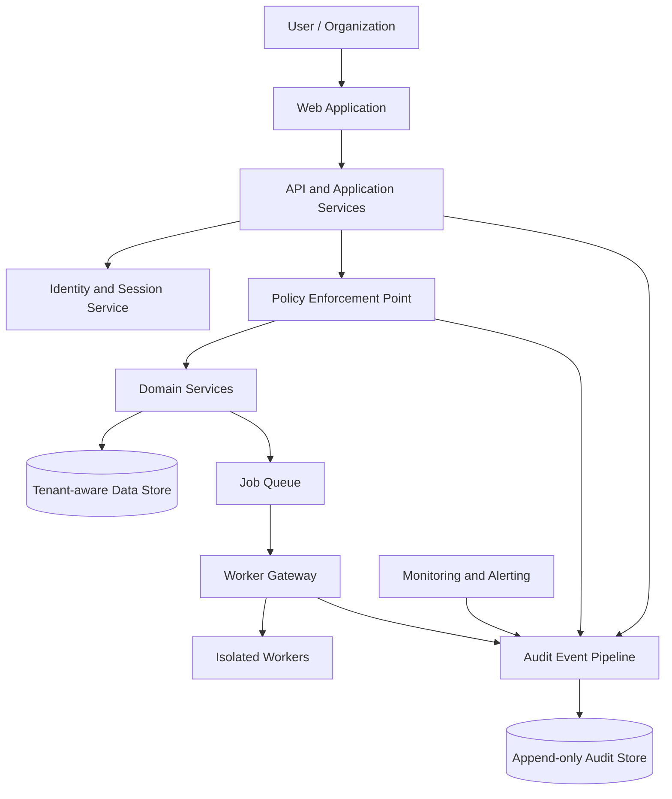

# CyberNorf — Initial Architecture

**Status:** Mixed. The [implemented Phase 1 foundation](#implemented-phase-1-foundation) section describes code that exists and is covered by automated tests. Everything after it describes the target design for later phases and is not implemented.

## Goals

- Build a defensive-security platform with auditable workflows.
- Keep identity, authorization, execution, and data-access responsibilities separate.
- Make sensitive actions fail closed when required context or approvals are missing.
- Make it possible to test and reason about security boundaries independently.

## Implemented Phase 1 foundation

### Code map

| Area                                                          | Location                                                     |
| ------------------------------------------------------------- | ------------------------------------------------------------ |
| Identity provider (Better Auth) and auth HTTP surface         | `src/lib/auth.ts`, `src/app/api/auth/[...all]/route.ts`      |
| Browser auth client                                           | `src/lib/auth-client.ts`, `src/lib/api-client.ts`            |
| Server-rendered session helpers                               | `src/server/ui/session.ts`                                   |
| Capability policy                                             | `src/server/authz/roles.ts`                                  |
| Tenant context and second-factor gate                         | `src/server/authz/context.ts`                                |
| Route wrappers (metadata, CSRF, rate limit, authz, errors)    | `src/server/api/handler.ts`                                  |
| Error model                                                   | `src/server/errors.ts`                                       |
| Request metadata, same-origin check, bounded JSON body parser | `src/server/http/request-meta.ts`                            |
| Audit append, hash chain, verifier                            | `src/server/audit/audit.ts`, `src/server/audit/canonical.ts` |
| Domain services                                               | `src/server/services/*.ts`                                   |
| Input validation                                              | `src/server/validation/*.ts`                                 |
| Workflow state machines                                       | `src/server/domain/transitions.ts`                           |
| Agent domain rules (tokens, scopes, lifecycle)                | `src/server/domain/agents.ts`                                |
| Agent bearer-token route wrapper                              | `src/server/api/agent.ts`                                    |
| Builtin offline host monitor                                  | `scripts/agent/monitor.mjs`                                  |
| UI routes and components                                      | `src/app/**`, `src/components/**`                            |
| Tests                                                         | `tests/*.test.ts`, `src/**/*.test.ts`                        |

### Request lifecycle

Every tenant API route is created with `withTenantApi(capability, options, handler)`:

1. Build request metadata: correlation ID (validated `X-Request-Id` or a UUID), client address from `X-Forwarded-For`/`X-Real-IP`, truncated user agent.
2. For any non-safe method, reject cross-site requests: `Sec-Fetch-Site: cross-site` and an `Origin` outside `BETTER_AUTH_URL` produce `403`. Requests that carry an `Authorization` header skip this check: a browser does not attach a bearer credential on its own, and a cross-site page cannot set the header without a CORS preflight.
3. Consume a fixed-window rate-limit entry in PostgreSQL. Defaults are 240 read requests and 60 writes per minute per client address; import, member management, organization creation, and audit verification have tighter per-user budgets. A bearer-authenticated request also consumes a key-scoped bucket, so one key cannot exhaust its owner's console budget and an address cannot hide behind a shared key.
4. Resolve the caller: an `Authorization: Bearer cnk_...` personal API key or the Better Auth session cookie. Missing, malformed, unknown, revoked, and expired credentials all produce the same `401`, and a bearer header that is present but unusable never falls back to the cookie.
5. Resolve the organization from the path slug, require an `ACTIVE` membership, verify the capability for this route, and require a TOTP second factor for privileged roles on mutating capabilities. A personal API key is bound to one organization and receives `404` for any other, including ones its owner belongs to. Denials produce `403` (`FORBIDDEN` or `MFA_REQUIRED`) and append an `access.denied` audit event.
6. Parse a bounded JSON body (`415` for the wrong content type, `413` above 256 KB, or 1 MB for the bulk import endpoint) and validate it with Zod (`422` with field details). At most 500 findings may be imported per request.
7. Call the domain service, which re-scopes every query by the resolved organization ID and writes the mutation plus its audit event in one transaction.
8. Serialize with `Cache-Control: no-store`, `X-Request-Id`, `X-Content-Type-Options: nosniff`, and `Referrer-Policy: no-referrer`. Errors use one shape: `{ "error": { "code", "message", "requestId" } }`, with no stack traces or internal identifiers.

Server-rendered pages use the same authorization primitives: `requireSessionUser` and `loadTenantContext` run on the server before any tenant data is read, and a denied capability renders an access-denied view instead of partial data.

### Data model

All tenant rows carry `organizationId` and are only reachable through a resolved membership.

| Model                                                                  | Purpose and notable constraints                                                                                                                                                                                                                                                                                                   |
| ---------------------------------------------------------------------- | --------------------------------------------------------------------------------------------------------------------------------------------------------------------------------------------------------------------------------------------------------------------------------------------------------------------------------- |
| `User`, `Session`, `Account`, `Verification`, `TwoFactor`, `RateLimit` | Better Auth identity tables, generated by the library.                                                                                                                                                                                                                                                                            |
| `Organization`                                                         | Tenant root. `slug` is unique and restricted to lowercase hostname-safe characters. `tier` is recorded but gates no capability in v1.                                                                                                                                                                                             |
| `Membership`                                                           | `role` (`OWNER`, `ADMIN`, `ANALYST`, `VIEWER`) and `status` (`ACTIVE`, `DISABLED`), unique per user and organization. Removal is a soft disable.                                                                                                                                                                                  |
| `Asset`                                                                | Organization-owned inventory: type, identifier, criticality, lifecycle status, and `verificationStatus`. Identifier is unique per organization. `verificationStatus` records an operator declaration only; no DNS or IAM proof is implemented.                                                                                    |
| `Finding`                                                              | Vulnerability or observation with severity, status, source (`MANUAL`, `IMPORT`, or `AGENT`), a fingerprint unique per organization used for deduplication, optional CVE, CVSS score, asset, assignee, incident, optional `agentId` provenance, and remediation text.                                                              |
| `Incident`                                                             | Investigation record with severity, status, detection and closure timestamps, assignee, and linked findings.                                                                                                                                                                                                                      |
| `IncidentNote`                                                         | Append-only-by-convention investigation notes with author and body.                                                                                                                                                                                                                                                               |
| `Framework`, `FrameworkControl`                                        | Global read-only catalog of compliance frameworks and their controls. Seeded by migration, identical for every tenant, and ordered by an explicit `position` so the list reads like the standard.                                                                                                                                 |
| `OrganizationFramework`                                                | One tenant's adoption of a catalog framework, unique per organization and framework, with adoption date, adopting user, and an optional target audit date.                                                                                                                                                                        |
| `OrganizationControl`                                                  | Per-tenant attestation of one catalog control: status, owner, notes, review dates, and who last updated it. Unique per adoption and control. A CHECK constraint requires `lastReviewedAt` whenever the status is `PARTIAL` or `IMPLEMENTED`.                                                                                      |
| `ControlEvidence`                                                      | Audit-grade support for a control, pointing at exactly one finding, incident, asset, or external reference. A CHECK constraint enforces the single-target rule in the database as well as in validation.                                                                                                                          |
| `Agent`                                                                | Scoped monitoring agent: source (`BUILTIN`, `OPENAI`, `ANTHROPIC`, `CUSTOM`, `OTHER`), status, granted scopes, SHA-256 `tokenHash` (unique), display prefix, expiry, approval and revocation stamps, last-seen counters, the operator's expected reporting interval, and the pending-outage marker. Unique name per organization. |
| `AgentRun`                                                             | One submitted monitoring run: host, platform, timing, derived pass/fail/skip counts, linked findings, and the raw check array. Runs are immutable history; findings carry the operational state.                                                                                                                                  |
| `CheckControlMap`                                                      | Operator-declared link between a monitoring check id and one control of an adopted framework. Unique per organization, check and control. Mapped checks file their findings as control evidence automatically.                                                                                                                    |
| `NotificationChannel`                                                  | Tenant alert destination: HTTPS URL, AES-256-GCM sealed signing secret, enable flag, and last-delivery state. Unique name per organization.                                                                                                                                                                                       |
| `NotificationEvent`                                                    | Outbox row for one delivery: type (`AGENT_OFFLINE`, `AGENT_RECOVERED`, `TEST`), JSON payload, status, attempt counter, next-attempt time, delivery time, and last error. Unique `(channelId, dedupeKey)` so a repeated sweep cannot page twice.                                                                                   |
| `Advisory`                                                             | Tenant advisory feed entry: identifier (CVE, GHSA, or vendor id), package name, ecosystem (`BREW`, `NPM`, `PYPI`, `APT`, `RPM`), severity, affected version range in npm syntax, fixed version, CVSS score, reference URL, and publication date. Unique per organization, identifier, and package name.                           |
| `SoftwareItem`                                                         | Last-known package on a host, reported by an agent: ecosystem, name, version, first and last seen timestamps, and the resolved asset. Unique per agent, ecosystem, and name, so a package disappears when a run stops reporting it.                                                                                               |
| `UserApiKey`                                                           | Personal API credential for the console API: owner, single organization, SHA-256 `keyHash` (unique), six-character display prefix, required expiry, last-use timestamp, and revocation stamp. CHECK constraints enforce the digest shape and a prefix that cannot hold more than the six display characters.                      |
| `AuditEvent`                                                           | Hash-chained, append-only security record (see below).                                                                                                                                                                                                                                                                            |
| `ApiRateLimit`                                                         | Shared fixed-window counters for application routes.                                                                                                                                                                                                                                                                              |

### Roles and capabilities

The matrix lives in `src/server/authz/roles.ts` and is the single source of truth.

| Capability                                                  | OWNER | ADMIN | ANALYST | VIEWER |
| ----------------------------------------------------------- | :---: | :---: | :-----: | :----: |
| `organization.read`                                         |  yes  |  yes  |   yes   |  yes   |
| `asset.read`, `finding.read`, `incident.read`, `audit.read` |  yes  |  yes  |   yes   |  yes   |
| `asset.create`, `asset.update`                              |  yes  |  yes  |   yes   |   no   |
| `finding.create`, `finding.update`, `finding.import`        |  yes  |  yes  |   yes   |   no   |
| `incident.create`, `incident.update`, `incident.note`       |  yes  |  yes  |   yes   |   no   |
| `asset.delete`, `finding.delete`, `incident.delete`         |  yes  |  yes  |   no    |   no   |
| `compliance.read`                                           |  yes  |  yes  |   yes   |  yes   |
| `compliance.evidence`                                       |  yes  |  yes  |   yes   |   no   |
| `compliance.manage`                                         |  yes  |  yes  |   no    |   no   |
| `agent.read`                                                |  yes  |  yes  |   yes   |  yes   |
| `agent.manage`                                              |  yes  |  yes  |   no    |   no   |
| `notification.read`, `advisory.read`                        |  yes  |  yes  |   yes   |  yes   |
| `notification.manage`, `advisory.manage`                    |  yes  |  yes  |   no    |   no   |
| `organization.update`, `organization.manage_members`        |  yes  |  yes  |   no    |   no   |

`OWNER` and `ADMIN` must have a TOTP second factor enrolled before any mutating capability succeeds. Unknown roles and unlisted capabilities are denied.

`agent.manage` admits administrators to registration, but approval, suspension, resumption, and revocation are additionally restricted to `OWNER` inside the service, because they issue or destroy a credential.

### Workflow state machines

- Findings: the main path is `OPEN → TRIAGED → IN_PROGRESS → RESOLVED`, with `ACCEPTED_RISK` and `FALSE_POSITIVE` as further closure states. An `IN_PROGRESS` finding can be sent back to `TRIAGED`, and any closed finding can be reopened to `OPEN` or `TRIAGED`. Only transitions in the table in `src/server/domain/transitions.ts` are accepted; anything else returns `409 CONFLICT`. `resolvedAt` is set only when a finding becomes `RESOLVED`.
- Incidents: `OPEN → INVESTIGATING → CONTAINED → RESOLVED → CLOSED`, with a documented path back from `CONTAINED` to `INVESTIGATING`, from `RESOLVED`/`CLOSED` to `OPEN`, and from `OPEN` straight to `CONTAINED` or `CLOSED`. Resolution and closure timestamps are recorded on those transitions.

### Compliance posture

Frameworks are adopted per tenant; adoption creates one attestation row per catalog control at `NOT_STARTED`. The score is weighted, not a green-row count (`src/server/domain/compliance.ts`):

- Credit per control: `IMPLEMENTED` 1, `PARTIAL` 0.5, `IN_PROGRESS` 0.25, `NOT_STARTED` 0.
- `NOT_APPLICABLE` leaves the denominator instead of counting as a pass, so marking everything inapplicable cannot manufacture a high score.
- Score is `credited weight / applicable weight`, one decimal, and is banded `READY` (>=90), `PROGRESSING` (>=60), `AT_RISK`, or `NOT_ASSESSED` when nothing applicable remains.
- A control can only move to `IMPLEMENTED` with at least one piece of evidence attached; the mutation returns `409 CONFLICT` otherwise. Moving into `PARTIAL` or `IMPLEMENTED` stamps `lastReviewedAt`.
- Evidence must belong to the same tenant. Cross-tenant identifiers resolve as `404`, the same as an unknown id.
- The last piece of evidence of an `IMPLEMENTED` control cannot be deleted until the status steps back, and a framework cannot be withdrawn while any evidence is attached. Both rules keep the audit record from disappearing behind a status change.
- Attested controls with no evidence (for example after the referenced finding was deleted) are surfaced as integrity warnings rather than silently lowering the score.

The bundled catalog is a curated subset of each standard (SOC 2, ISO/IEC 27001, NIST CSF 2.0, PCI DSS, GDPR) and explicitly not the complete control text; the UI and API label it as a tracking aid rather than a legal opinion or a certification.

### Monitoring agents

Agents collect host evidence and submit it to CyberNorf. The platform never calls a model provider, so monitoring keeps working on a network with no outbound Internet access; the only network action is the agent's own request to your instance.

- Sources: `BUILTIN` (the bundled `scripts/agent/monitor.mjs`), `OPENAI`, `ANTHROPIC`, `CUSTOM`, and `OTHER`. The source is provenance, not trust: every source goes through the same scoped report endpoint.
- Approval: a `BUILTIN` agent is registered by an owner or administrator and starts `ACTIVE`, because the operator is installing it on a host the organization already owns. Every external source is created `PENDING_APPROVAL` with no token hash at all, and only an `OWNER` can approve it. Approval issues the credential and may narrow the requested scopes; it cannot widen them.
- Credentials: `cna_` plus 32 random bytes, base64url. Only the SHA-256 hash is stored, plus a six-character display prefix. Builtin tokens live 365 days and third-party tokens 90 days. The plaintext token is returned exactly once, from registration or approval, and cannot be recovered afterwards.
- Scopes: `monitor.report` submits runs, `monitor.read` reads the agent's own record and history. A request outside the granted set returns `403`. Agent routes are wrapped by `withAgentApi`, which reads only the `Authorization: Bearer` header, never a session cookie, and rate-limits 60 requests per minute per address before authentication and 120 per minute per agent afterwards.
- Lifecycle: `PENDING_APPROVAL → ACTIVE → SUSPENDED → ACTIVE`, with `REVOKED` reachable from every non-revoked state and terminal. Suspension keeps history but stops the credential; revocation clears the token hash as well as the status. An active agent's credential can be rotated in place by an owner: the row, its runs and its check mappings are kept, only the hash, prefix and expiry change, and `agent.token_rotated` records both prefixes.
- Signed submissions: the monitor signs `x-cybernorf-timestamp` and `x-cybernorf-signature` (HMAC-SHA256 over `<seconds>.<raw body>`, key derived from the agent token). The runs route verifies against the raw bytes before parsing, rejects a timestamp outside five minutes, and always rejects a signature that arrives but does not verify. `AGENT_REQUIRE_SIGNED_RUNS=true` additionally refuses unsigned submissions, which also protects against a leaked token being used without the key derivation; rotation invalidates both at once.
- Ingestion: the agent sends observations only. `POST /api/v1/agents/me/runs` derives the run status (every check skipped is `PARTIAL`, no checks at all is `FAILED`), the pass/fail/skip counts, and the findings. Each failed check creates or refreshes one finding keyed by a fingerprint over organization, check id, and target, attributed to the agent's registering operator with `source = AGENT` and `agentId` set. A finding a person already resolved, accepted as risk, or marked a false positive is not reopened by a later run; the run reports it as suppressed instead.
- History: runs are immutable; the console drills down from an agent to its runs and from a run to the checks and linked findings. Every registration, approval, suspension, resumption, revocation, and accepted run appends to the audit chain, with `actorType = AGENT` for runs.
- Compliance: `CheckControlMap` links a check id to a control of a framework the tenant adopted. A failing mapped check files its finding as `ControlEvidence` (`kind = FINDING`) and audits `compliance.evidence_added` as an agent action, so technical telemetry becomes audit evidence without anyone copying it by hand. Attachments are idempotent per finding; unmapping stops future attachments and keeps what was already filed.
- Offline operation: `monitor.mjs` has no dependencies beyond Node. It collects locally, can write a report with `--out` on an air-gapped host, and can submit a carried report with `--in` from a connected host. A check whose evidence is unreadable is reported `SKIP` rather than passed, so reduced coverage is visible instead of implied assurance.
- Software inventory: a run may carry up to 800 packages (`inventory`). The server resolves the report hostname to a tenant asset, creating a `HOSTNAME` asset when the host is new, and replaces that agent's snapshot with the reported list, so an uninstalled package does not linger. Each package is then matched against the tenant's advisories of the same ecosystem: name comparison is case-insensitive, ecosystems never cross-match, and the range is evaluated by the comparator in `src/server/domain/versions.ts`. A match creates one finding per advisory and host (`<package> <version> is affected by <identifier>`, `source = AGENT`, `cveId` set only when the identifier is a CVE, remediation naming the fixed version). A repeat run refreshes that finding instead of duplicating it, and a finding a person closed is left alone. Importing an advisory does not scan retroactively; the next run of each agent performs the match.
- Heartbeats: an agent with an expected interval is `ONLINE`, `STALE`, or `OFFLINE` based on how many intervals have passed since its last run. `GET /api/cron/notifications` performs one bounded sweep and delivery pass, authenticated by a constant-time `CRON_SECRET` bearer check that fails closed with `503` when unconfigured. A host that stops reporting queues one alert per enabled destination, deduplicated per outage, and a host that reports again queues a recovery while dropping any outage alert that has not been sent yet. Delivery is a signed webhook (`x-cybernorf-signature` over timestamp and body) with five backoff attempts; attempts are claimed atomically so overlapping sweeps cannot double-send.

### Audit trail

Appends are transactional with the mutation, have a per-organization advisory lock, and are chained with SHA-256 over a canonical serialization (`sequence`, previous hash, actor, action, outcome, target, summary, metadata, timestamp). A database trigger rejects `UPDATE` and `DELETE`. `GET /api/v1/organizations/:orgSlug/audit/verify` recomputes the chain and reports the first broken sequence; the audit page exposes the same check.

### Data lifecycle

Operational history is separated from business records. An operator-run CLI (`npm run data:retention`) purges only derived history — agent runs, terminal alert deliveries, and package snapshots whose agent stopped reporting — after a configurable number of days, and appends one `retention.purged` audit event carrying the cutoff and the row counts. Findings, incidents, assets, compliance evidence, and audit events are never removed by a timer: closing them is a human decision, and the audit chain is append-only by trigger. `npm run data:export` writes one organization's records to a JSON document whose select lists omit every credential (agent token hash and prefix, sealed webhook secret, sessions, password hashes, second-factor secrets) while keeping the audit chain's hashes so the file verifies on its own. Neither script runs on a scheduler; deployments wire them into cron or a systemd timer.

### UI surfaces

- Public: landing page, `sign-in`, `sign-up`, `two-factor` challenge.
- Account: `account/security` for TOTP enrollment and backup codes, and for creating, listing, and revoking personal API keys with a one-time reveal.
- Tenant workspace under `/app/:orgSlug`: dashboard, assets (list and detail), findings (list, detail, status control, JSON import), incidents (list, detail, notes, linked findings), compliance (posture overview, framework detail with attestations, control detail with evidence), agents (list with derived health, registration with one-time token reveal, detail with approval, lifecycle controls, heartbeat interval, compliance mapping, software inventory, run drill-down), advisories (import form with a sample entry, feed table, delete), audit (filters and chain verification), members, and settings (organization profile and alert destinations with a recent-delivery table).
- Navigation renders only capabilities the current membership holds, but enforcement always happens on the server.

### Known limitations of this phase

- Document-level security headers (CSP, HSTS in production, `X-Frame-Options`, COOP, Permissions-Policy) come from `next.config.ts` for every route. The CSP still allows inline scripts, because Next.js emits its bootstrap script without a nonce; a nonce pipeline is on the roadmap.
- No password reset, email verification, or invitation email flow. People must register before an owner or administrator can add them.
- No file upload. Data leaves through `npm run data:export` (a per-organization JSON file, no credentials) rather than a console download. Compliance evidence links to existing findings, incidents, and assets, or to an external reference string; documents are not stored.
- Rate-limit windows and derived history are pruned only by the operator-run `npm run data:retention`, never by a scheduler. That purge cannot remove audit events, and deleting a finding in the console still cascades to its `ControlEvidence` rows, so evidence must be exported first if it matters.
- The audit chain is hash-linked but not signed.
- No in-process background worker or job queue. Agents run on their own schedule (cron, `launchd`, Task Scheduler), and the platform never initiates a scan. Offline detection and webhook delivery depend on an external scheduler calling `/api/cron/notifications`; with no scheduler configured, alerts queue but are not retried.
- Token rotation is manual and per agent: there is no rotation schedule, no overlap window (the previous token stops working immediately), and no alert when a token is about to expire.
- Signature enforcement is opt-in per deployment. A deployment that leaves `AGENT_REQUIRE_SIGNED_RUNS` unset still accepts an unsigned but valid bearer token, so a leaked token can submit observations without knowing the signing key only until the flag is turned on.
- The monitor's checks are a conservative baseline for Linux, macOS and Windows hosts; they are not a CIS benchmark. Windows coverage is limited to Defender state and signature age, SMBv1, RDP network-level authentication, the Guest account and update recency, and it is read through `powershell.exe` rather than a signed PowerShell script that would resist tampering.
- The advisory feed is imported by hand (a JSON array or `{ "advisories": [...] }`); CyberNorf does not fetch NVD, OSV, or vendor feeds itself, so there is no scheduled sync and no automatic expiry of old entries. Matching happens on the next agent run, not at import.
- Advisory matching compares exact package names within one ecosystem. It does not resolve dependency trees, distributions that rename packages, or kernel and driver versions, and a range that cannot be parsed matches nothing rather than everything.
- The monitor collects `brew list --versions`, `npm ls -g --json`, `pip list`, `dpkg-query`, and `rpm -qa`. macOS applications installed as `.app` bundles (`pkgutil --pkgs`) are not collected, and the report is capped at 800 packages.
- Webhook delivery has no dead-letter review UI beyond the recent-delivery table, and a destination whose signing secret is lost (for example after replacing `BETTER_AUTH_SECRET`) must be deleted and re-created.
- Personal API keys carry no scopes beyond the owner's live role, no IP allowlist, and no rotation schedule or expiry reminder. A key is a single-organization credential created only from the account settings page; it cannot mint another key, and revoking it is immediate with no overlap window.

## Target logical components (later phases)

All boxes are target logical boundaries. They may be deployed differently, but their responsibilities should remain explicit.

### Reference deployment

`compose.prod.yaml` implements one supported topology: a Caddy reverse proxy that terminates TLS and is the only published service, one `app` container, a one-shot `migrate` container built from the same image, and PostgreSQL on an internal network. The database connection is verified TLS with a certificate generated on first boot, and the app runs unprivileged with a read-only root filesystem. The reasoning and the trade-offs are in [ADR 0004](decisions/0004-production-deployment.md); the operator steps are in [DEPLOYMENT.md](DEPLOYMENT.md). Managed hosting, multiple app instances, and high availability remain open.

## Component responsibilities

### Web application

- Present workflows and current permission state.
- Never be the sole enforcement point for authorization.
- Avoid placing secrets in browser storage or URLs.
- Treat user-submitted content and rendered analysis as untrusted.

### API and application services

- Authenticate every request that requires an identity.
- Validate inputs at trust boundaries.
- Invoke centralized authorization checks for sensitive operations.
- Apply rate limits, request-size limits, and safe error handling.
- Avoid exposing stack traces, internal identifiers, or secret-bearing payloads.

### Identity and sessions

- Support MFA for privileged accounts and stronger verification for high-risk access.
- Use secure session rotation and revocation.
- Enforce tenant membership and role changes server-side.
- Record important authentication and administrative events without logging credentials.

### Policy enforcement

For each sensitive action, evaluate the actor, organization, requested capability, target, engagement scope, time window, approval state, and contextual risk. Deny by default if a required check is missing or invalid.

Prefer short-lived, scoped authorization grants over permanent broad permissions. A granted profile is not universal permission to target arbitrary systems.

### Domain services

Keep SOC cases, indicators, findings, assets, engagements, and reports in separate modules with explicit ownership and access rules. Record provenance for imported intelligence and evidence.

### Job queue and isolated workers

- Never execute untrusted samples or active tests inside the API process.
- Use disposable workers or equivalent isolation appropriate to each workload.
- Restrict outbound network access by default.
- Apply CPU, memory, disk, process, and execution-time limits.
- Use narrowly scoped service credentials; do not pass the main application secret to workers.
- Validate target scope at dispatch and, where practical, again at execution.
- Support cancellation, worker teardown, and retention limits.
- Treat network allowlists as defense in depth, not proof of authorization.

### Data store and file handling

- Enforce tenant boundaries in service logic and, where supported, at the data layer.
- Encrypt data in transit and at rest.
- Keep secrets in a dedicated secrets manager or equivalent secure facility.
- Store file metadata and content separately where useful; use content hashing and size/type limits.
- Quarantine uploads and avoid trusting filenames or claimed content types.
- Define deletion and retention behavior before handling real customer data.

### Audit pipeline

Capture actor, organization, action, target reference, authorization decision, correlation ID, timestamp, and result for security-relevant events. Avoid retaining unnecessary sensitive payloads. Restrict modification and deletion of audit records, monitor audit-pipeline failures, and test export integrity.

## Authorization decision model

A sensitive request should proceed only when all required checks pass:

1. The user and session are valid.
2. The account and organization are active.
3. The role grants the requested capability.
4. The target is within an explicit approved scope, if applicable.
5. The authorization is current and has not been revoked.
6. Required approvals and safety checks are satisfied.
7. Resource limits and execution guardrails are in place.

UI hiding is not enforcement. API handlers and execution workers must apply server-side checks.

## Target domain model for later phases

The Phase 1 entities (`User`, `Organization`, `Membership`, `Asset`, `Finding`, `Incident`, `IncidentNote`, `AuditEvent`) and the compliance catalog and attestation entities (`Framework`, `FrameworkControl`, `OrganizationFramework`, `OrganizationControl`, `ControlEvidence`) exist with migrations. Later phases add:

- `Engagement`, `ScopeEntry`, `Approval` for authorized-assessment records;
- `Indicator`, `EvidenceArtifact` for threat intelligence and evidence;
- `Job`, `RetentionPolicy` for the execution layer and data lifecycle;
- `PolicyDecision` if decision logging grows beyond the current audit events.

Every organization-owned record should have an explicit ownership model. Avoid trusting client-supplied organization IDs; derive or validate them from the authenticated membership.

## Operational prerequisites

Before production use, document:

- supported deployment model and trust boundaries;
- backup, restoration, and disaster-recovery procedures;
- monitoring, incident handling, and credential rotation;
- dependency and container-image update process;
- data residency, subprocessors, retention, and deletion;
- security testing and release acceptance criteria.

## Architecture decisions still open

Accepted decisions:

- [ADR 0001](decisions/0001-application-stack.md) — v1 application stack.
- [ADR 0002](decisions/0002-identity-and-sessions.md) — identity, sessions, and second factors.
- [ADR 0003](decisions/0003-authorization-and-audit.md) — capability authorization, tenant scoping, and tamper-evident audit.
- [ADR 0004](decisions/0004-production-deployment.md) — single-host production deployment with a TLS proxy.

The following deployment and product decisions remain open:

- cloud-hosted or hybrid deployment (self-hosting is covered by ADR 0004);
- single-tenant versus multi-tenant launch;
- required integrations and data volume;
- whether uploaded samples or security tools will execute in the platform;
- hosting, operating budget, and support expectations.

Record material choices and their trade-offs in architecture decision records as they are approved.
