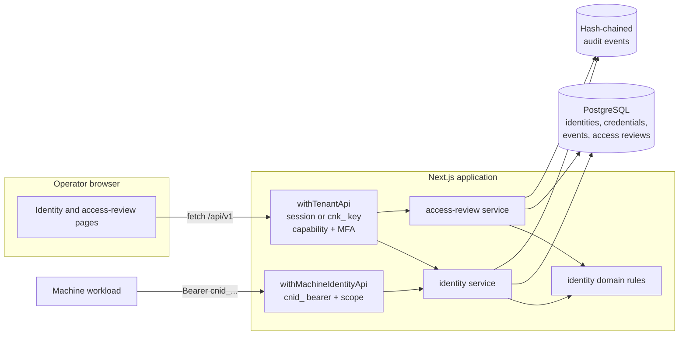

# CyberNorf — Identity Governance

**Status:** Implemented and verified on 2026-11-11. The code, migration, UI, automated tests and operator guidance described here exist in this repository. Known gaps are listed in [Implementation status](#implementation-status) rather than implied to be finished.

This module is the first phase of the proposed Zero Trust IAM/NAC/NDR subsystem. CyberNorf already uses "Phase 1" for its shipped SOC foundation, so this document calls the new work the **identity-governance module** and reserves "Zero Trust Phase 1" for the programme label. It does not renumber or change the existing roadmap.

Related decisions: [ADR 0002](decisions/0002-identity-and-sessions.md) (identity and sessions), [ADR 0003](decisions/0003-authorization-and-audit.md) (capability authorization and audit), and [ADR 0005](decisions/0005-identity-governance.md) (this module).

## Repository assessment

### What already existed

CyberNorf is a Next.js App Router application backed by PostgreSQL and Prisma. The parts that matter to this module were already in place:

- Better Auth sessions, optional OIDC, TOTP second factors and personal API keys (`cnk_...`).
- Organization memberships with `OWNER`, `ADMIN`, `ANALYST` and `VIEWER` roles.
- A capability policy (`src/server/authz/roles.ts`) and a tenant context that resolves the organization from the URL slug and enforces active membership and MFA for mutating capabilities (`src/server/authz/context.ts`).
- A route wrapper that applies request metadata, same-origin checks, rate limits, authentication, capability checks, bounded JSON parsing and a uniform error shape (`src/server/api/handler.ts`).
- An append-only, hash-chained audit log written in the same transaction as the mutation (`src/server/audit/audit.ts`).
- Tenant-scoped services and Zod validation (`src/server/services/*.ts`, `src/server/validation/*.ts`).
- Server-rendered pages with client components for mutations, using the existing API client and action forms.
- A `node:test` suite run with `tsx` against a real PostgreSQL test database.

### Gaps this module addresses

Before this change the repository had assets, findings, incidents, agents and personal API keys, but no unified identity inventory and no governance workflow:

- No record for a human account that is not a CyberNorf user, or for a non-human workload that is not a monitoring agent.
- No accountable owner, ownership review or lifecycle state for machine identities.
- No scoped machine credential that can be issued, rotated and revoked independently of an agent token.
- No recertification campaign for organization memberships.
- No object-level identity timeline separate from the organization audit chain.

### Conventions reused

| Need              | Existing mechanism reused                                                     |
| ----------------- | ----------------------------------------------------------------------------- |
| Tenant resolution | `withTenantApi` and `requireTenantContext`                                    |
| Authorization     | Four new capabilities added to the existing role sets                         |
| Second factor     | `identity.manage` and `access_review.manage` added to `MUTATING_CAPABILITIES` |
| Audit             | `appendAuditEvent` inside the same Prisma transaction as each mutation        |
| Errors            | Existing `AppError` helpers and `toErrorResponse`; no new error envelope      |
| Rate limits       | `enforceRateLimit` backed by the shared PostgreSQL counter table              |
| UI                | Existing page shell, navigation, `ActionForm`, `ActionButton` and API client  |
| Validation        | Zod schemas in `src/server/validation/`, parsed at the route boundary         |
| Tests             | `tests/helpers/database.ts`, real database, `expectAppError`, route imports   |

### Constraints and deliberate exclusions

- **No second account system.** An `Identity` is an inventory object, not an authentication principal. Console authentication remains Better Auth; organization access remains `Membership`. A `HUMAN` identity can optionally link to a `User`, but the link does not grant or remove access by itself.
- **No connector ingestion.** `IdentitySource` has only `MANUAL` and `IMPORT`; no SCIM, OIDC or agent-discovery importer exists, so nothing claims a source it cannot populate.
- **No mTLS and no workload attestation.** Machine credentials are opaque bearer tokens. There is no certificate binding, IP allowlist or proof of workload identity.
- **No PostgreSQL row-level security.** Tenant isolation is enforced by mandatory `organizationId` predicates in services and by the resolved tenant context. This matches the rest of the repository and is tested, but it is not defence in depth at the database layer.
- **One machine scope in this release.** The scope catalog contains only `identity.self.read`, the minimum needed for a machine to describe itself.
- **No notifications.** Due dates and expiring credentials are visible in the console but no email or webhook is sent.
- **No access-review coverage of machine identities.** Reviews snapshot `Membership` rows, so they cover console access only.

### Alternatives considered

| Alternative                                           | Why it was not chosen                                                                                                                                                                 |
| ----------------------------------------------------- | ------------------------------------------------------------------------------------------------------------------------------------------------------------------------------------- |
| Reuse `Agent` as the machine identity record          | `Agent` carries monitoring-run semantics, token scopes and an approval lifecycle specific to host monitoring; a service account is not an agent.                                      |
| Treat every identity as a `User`                      | Non-human workloads and unlinked humans must not become login-capable accounts merely to be inventoried.                                                                              |
| Store credential plaintext or a reversible ciphertext | A database reader would be able to impersonate every machine. Only a SHA-256 digest and a short display prefix are stored.                                                            |
| Issue self-contained JWTs for machines                | Revocation would depend on short lifetimes or a denylist. An opaque token checked against the database gives immediate revocation.                                                    |
| Put review decisions on `Membership` directly         | A review needs a durable snapshot, a per-reviewer decision and an immutable outcome; overwriting membership state would lose that history.                                            |
| Add a `DRAFT` access-review state                     | A saved review is already actionable in this phase; a draft adds a state transition without adding a control.                                                                         |
| Build a separate microservice                         | The module needs the same tenant context, audit chain and database transaction boundaries; a second service would add deployment and consistency cost before there is a scale reason. |

## Scope

### In scope

- Human and machine identity inventory, canonical identifiers, type and criticality.
- Accountable ownership and optional linkage between a human identity and a console account.
- Lifecycle: pending approval, active, suspended and deprovisioned, with append-only object events.
- Machine credentials: scoped, expiring, hashed, rotated and revoked.
- Recertification of organization memberships with explicit `RETAIN` and `REVOKE` decisions.
- Tenant-isolated API, server-rendered UI, audit events and automated tests.
- Operator documentation and a documented threat model.

### Out of scope

- Replacing Better Auth, session issuance or organization membership.
- Making identity status a login gate for console users.
- NAC enforcement, network discovery, device posture or NDR telemetry.
- SCIM/OIDC/CSV import, HR-driven joiner/mover/leaver automation.
- Password management, hardware keys, mTLS or workload identity attestation.
- Just-in-time access, break-glass workflows or approval of individual scope expansions.
- Email, chat or webhook notification of review due dates and credential expiry.

## Architecture

### Control planes

The module separates three callers:

1. **Console management plane.** A Better Auth session or personal API key calls `/api/v1/organizations/[orgSlug]/...` through `withTenantApi`. The wrapper resolves the tenant, checks the capability and, for mutations, requires a second factor on privileged roles.
2. **Machine data plane.** A machine presents `Authorization: Bearer cnid_...` to `/api/v1/identity/me` through `withMachineIdentityApi`. The token is hashed and looked up, the identity must be `ACTIVE`, the credential must be unexpired and unrevoked, and the requested scope must be on the credential. No cookie is accepted.
3. **Governance plane.** Access reviews snapshot active memberships at creation. Reviewers record decisions; finalization applies revocations in one transaction.

### Component diagram



### Dependency map

| Component                            | Path                                                                          | Depends on                                                                 | Consumed by                                  |
| ------------------------------------ | ----------------------------------------------------------------------------- | -------------------------------------------------------------------------- | -------------------------------------------- |
| Identity domain rules                | `src/server/domain/identity.ts`                                               | `node:crypto`, generated Prisma enums                                      | Validation, services, server pages           |
| Identity validation                  | `src/server/validation/identities.ts`                                         | Zod, domain constants                                                      | Tenant routes, server pages                  |
| Identity service                     | `src/server/services/identities.ts`                                           | Prisma, domain rules, tenant context, audit, errors, shared helpers        | Tenant identity routes, machine route, pages |
| Access-review service                | `src/server/services/access-reviews.ts`                                       | Prisma, tenant context, audit, errors, shared helpers                      | Tenant access-review routes, pages           |
| Machine API wrapper                  | `src/server/api/identity.ts`                                                  | Credential verification, rate limiter, error model, request metadata       | `/api/v1/identity/me`                        |
| Tenant identity routes               | `src/app/api/v1/organizations/[orgSlug]/identities/**/route.ts`               | `withTenantApi`, identity service, validation                              | UI and API clients                           |
| Tenant access-review routes          | `src/app/api/v1/organizations/[orgSlug]/access-reviews/**/route.ts`           | `withTenantApi`, access-review service, validation                         | UI and API clients                           |
| Machine self route                   | `src/app/api/v1/identity/me/route.ts`                                         | `withMachineIdentityApi`, identity service                                 | Machine workloads                            |
| Identity UI                          | `src/app/app/[orgSlug]/identities/**`, `src/components/identities/**`         | Server pages call services directly; client components call the tenant API | Operators                                    |
| Access-review UI                     | `src/app/app/[orgSlug]/access-reviews/**`, `src/components/access-reviews/**` | Server pages call services directly; client components call the tenant API | Operators                                    |
| Authorization and audit registration | `src/server/authz/roles.ts`, `src/server/audit/audit.ts`                      | Existing capability and audit types                                        | Routes and services                          |
| Tests                                | `tests/identities.test.ts`, `tests/access-reviews.test.ts`                    | Test database helpers, services, audit verifier, route modules             | CI                                           |

### Data model

| Model                | Purpose                                 | Invariants enforced                                                                                                                      |
| -------------------- | --------------------------------------- | ---------------------------------------------------------------------------------------------------------------------------------------- |
| `Identity`           | One human or machine inventory object   | Identifier trimmed, lower-cased and non-empty; unique per organization; `MACHINE` cannot have `linkedUserId`; credential TTL 1–365 days. |
| `IdentityCredential` | Scoped bearer credential for a machine  | `keyHash` unique; only digest and prefix stored; plaintext returned once; revocation is a timestamp, never a delete.                     |
| `IdentityEvent`      | Object-level append-only timeline       | Database trigger rejects `UPDATE` and `DELETE`; actor is optional so system actions survive user deletion.                               |
| `AccessReview`       | One recertification campaign            | No draft state; `dueAt` strictly after `createdAt`; terminal `COMPLETED` or `CANCELLED`.                                                 |
| `AccessReviewItem`   | Snapshot of one membership under review | Unique per review and membership; `PENDING` requires null decision fields; a decision requires reviewer and timestamp.                   |

Both `Identity` and `IdentityCredential` cascade on organization deletion. A deleted `User` sets optional owner, approver and actor references to null, so history survives account removal. `AccessReviewItem` stores the member's name, email and role at review time; that snapshot is intentional but is personal data and is only readable through `identity.read`/`access_review.read`.

### Request flows

**Management request.** `withTenantApi` builds request metadata, applies the address and key rate limits, resolves the session or API key, loads the organization membership, checks the capability and applies the second-factor gate for mutating capabilities. The handler parses a bounded JSON body with Zod, calls a service, and the service re-scopes every read and write by `organizationId`. Cross-tenant IDs resolve to `404` rather than leaking existence. The mutation, its `IdentityEvent` and its hash-chained audit event are written in one transaction.

**Machine request.** The wrapper applies a pre-authentication address limit, hashes the bearer token, looks up an unrevoked, unexpired credential on an `ACTIVE` machine identity, updates last use, checks the credential scope, applies a per-credential limit, and returns the identity and credential description. Unknown, revoked, expired and suspended credentials all produce the same `401`. The plaintext token is never echoed.

**Access-review finalization.** Finalization runs in a transaction behind an advisory lock. It refuses while any item is `PENDING`. For each `REVOKE` item it disables the membership, deletes that user's sessions for the organization, and suspends a linked identity unless it is already deprovisioned. It refuses to revoke the last active owner. It then marks the review `COMPLETED`, writes per-member audit events and one completion event, and the access-review test verifies the resulting audit chain.

## Threat model

This section supplements `docs/THREAT_MODEL.md` with threats specific to identity governance. It assumes TLS is terminated correctly, the database is not attacker-controlled, and the existing authentication stack is not compromised.

### Assets and actors

- **Assets:** machine bearer tokens, personal API keys, session cookies, organization membership state, audit integrity, personal data in review snapshots.
- **Actors:** unauthenticated network attacker, authenticated viewer or analyst, compromised administrator session, malicious or careless administrator, compromised machine workload, database reader, former employee.

### Threats and controls

| ID  | Threat                                                      | Control                                                                                                                                                     | Residual risk                                                                                                    |
| --- | ----------------------------------------------------------- | ----------------------------------------------------------------------------------------------------------------------------------------------------------- | ---------------------------------------------------------------------------------------------------------------- |
| T1  | Cross-tenant read or write through a guessed ID or slug     | Tenant context from the slug; every query carries `organizationId`; cross-tenant tests at service and HTTP layers; `404` instead of a distinguishing error. | No database RLS. A future raw query that forgets the predicate would not be caught by the database.              |
| T2  | Machine token theft from the database                       | Only SHA-256 digest and six-character prefix stored; plaintext returned once; audit metadata records the prefix, not the token.                             | A database reader still sees prefixes and scopes; a proxy or process capture can see plaintext.                  |
| T3  | Token replay after theft                                    | Opaque token verified per request; immediate revocation; expiry; identity suspension; per-credential rate limit.                                            | No proof of possession, mTLS, IP binding or nonce. A stolen token works until revoked or expired.                |
| T4  | Scope escalation by issuing a credential with extra scopes  | Requested scopes must be a subset of the identity's `approvedScopes`; the scope catalog is closed; issuance requires `identity.manage`.                     | An administrator can expand `approvedScopes` directly; there is no second approver for scope expansion.          |
| T5  | Privileged insider approves a machine they control          | Machine creation requires an accountable owner; approval requires `OWNER`; every decision is audited with actor and request metadata.                       | An owner can still approve their own machine. Ownership is accountability, not separation of duties.             |
| T6  | Stale access survives a leaver or role change               | Reviews snapshot active memberships; explicit `RETAIN`/`REVOKE`; finalization disables membership, deletes sessions and suspends linked identities.         | Reviews are periodic and manual. Nothing links HR events, and a review can remain open past its due date.        |
| T7  | Reviewer approves their own access or colludes              | A reviewer cannot decide their own item; every item records the reviewer and timestamp; a campaign cannot complete with undecided items.                    | Two administrators can still approve each other. The control is separation of duties, not proof of independence. |
| T8  | Finalization removes every owner and locks the tenant out   | The service counts remaining active owners and refuses a review that would revoke the last one.                                                             | Concurrent membership changes outside the review are not coordinated with that count.                            |
| T9  | Audit or object history is edited to hide an action         | Hash-chained audit events; `identity_events` trigger rejects update and delete; no route exposes either mutation.                                           | A database superuser can disable triggers or rewrite the chain; there is no external anchor or WORM storage.     |
| T10 | Enumeration of identities, credentials or review membership | Capability checks on every route; paginated lists; rate limits; the machine endpoint returns one identity and no list; cross-tenant IDs are `404`.          | A holder of `identity.read` can see the whole tenant inventory by design; there is no field-level redaction.     |
| T11 | Inventory suspension mistaken for console suspension        | Linked-human suspension is refused while an active membership exists; UI and documentation distinguish the two.                                             | An operator can still assume the inventory enforces login. It does not; membership remains the access control.   |
| T12 | Orphaned machine after the owner leaves                     | Owner required at creation; deleting the owner nulls the field; `UNOWNED_MACHINE` is a high-severity risk signal.                                           | Nothing forces reassignment; there is no automatic suspension of an unowned machine.                             |

### Privacy

- The identity detail view exposes derived counters only: failed authentications in the last 24 hours, active session count and last activity. It does not return raw `AuthEvent` or `session` rows, which are global to a user across organizations.
- Review snapshots contain the member's name, email and role at review time. That is necessary to make a decision durable after the membership changes, but it means a review retains personal data. Organization deletion cascades the rows; there is no per-person erasure workflow yet.
- Audit metadata records identifiers, scopes, prefixes, credential IDs and review IDs. It does not record plaintext credentials or session tokens.

### Security assumptions

- `BETTER_AUTH_URL`, TLS termination, cookie flags and the reverse-proxy guard are configured as documented in `docs/DEPLOYMENT.md`.
- The application's database role is not a superuser and cannot disable triggers.
- Operators protect personal API keys and machine tokens outside this application; the console shows each token once.
- The scope catalog is code-reviewed. Adding a scope is a security change, not a configuration change.

## Phased implementation plan

| Phase                            | Scope                                                                                                                                                                                  | Status                                                               |
| -------------------------------- | -------------------------------------------------------------------------------------------------------------------------------------------------------------------------------------- | -------------------------------------------------------------------- |
| Zero Trust Phase 1 — Inventory   | Human and machine inventory, ownership, linkage, lifecycle, object timeline, scoped machine credentials, membership recertification, console UI, API, audit, tests, docs.              | Delivered in this change.                                            |
| Zero Trust Phase 2 — Intake      | SCIM/OIDC/CSV import with provenance and reconciliation; owner-approval workflow for scope expansion; review delegation; due-date and expiry notifications; import conflict reporting. | Planned. No connector code exists.                                   |
| Zero Trust Phase 3 — Assurance   | Machine-identity reviews, workload attestation or mTLS, continuous posture signals, risk-based recertification, exception workflow, metrics, traces and alerting.                      | Planned. Depends on Phase 2 identity data quality.                   |
| Zero Trust Phase 4 — Enforcement | NAC/NDR signal ingestion and policy decisions, continuous authorization, SIEM export, cross-system correlation and automated evidence.                                                 | Planned. Enforcement needs telemetry and policy engines not present. |

Each phase is additive. Nothing in Phase 2–4 is claimed to exist in this repository, and the roadmap in `ROADMAP.md` remains the authoritative status list.

## API reference

All management routes live under `/api/v1/organizations/{orgSlug}/` and accept either a session cookie or `Authorization: Bearer cnk_...`. Mutations require the `identity.manage` or `access_review.manage` capability, and privileged roles must have a verified second factor. Errors use the existing envelope:

```json
{ "error": { "code": "FORBIDDEN", "message": "...", "requestId": "..." } }
```

| Method   | Path                                                | Capability             | Body / notes                                                                                                      |
| -------- | --------------------------------------------------- | ---------------------- | ----------------------------------------------------------------------------------------------------------------- |
| `GET`    | `identities`                                        | `identity.read`        | Paginated list plus `overview` counters. Filters: `kind`, `type`, `status`, `search`, `sort`.                     |
| `POST`   | `identities`                                        | `identity.manage`      | Create. `201`; `X-Identity-Pending-Approval: true` when a machine awaits owner approval.                          |
| `GET`    | `identities/options`                                | `identity.read`        | Type catalog, scope catalog, TTL bounds and assignable active members.                                            |
| `GET`    | `identities/{id}`                                   | `identity.read`        | Detail with credentials, timeline and activity counters.                                                          |
| `PATCH`  | `identities/{id}`                                   | `identity.manage`      | Update details, owner, linkage, TTL or `approvedScopes`. Narrowing scopes revokes uncovered credentials.          |
| `POST`   | `identities/{id}/lifecycle`                         | `identity.manage`      | `{ "action": "APPROVE" \| "SUSPEND" \| "REACTIVATE" \| "DEPROVISION", "note"?: string }`. Approval is owner-only. |
| `POST`   | `identities/{id}/credentials`                       | `identity.manage`      | `{ "name": string, "ttlDays"?: number, "scopes"?: string[] }`. `201`; plaintext token appears once.               |
| `POST`   | `identities/{id}/credentials/{credentialId}/rotate` | `identity.manage`      | Revokes the old credential and issues a replacement in one transaction. `201`.                                    |
| `DELETE` | `identities/{id}/credentials/{credentialId}`        | `identity.manage`      | Revokes immediately. Idempotence is not assumed: a second call returns `409`.                                     |
| `GET`    | `access-reviews`                                    | `access_review.read`   | Paginated campaigns with progress counters.                                                                       |
| `POST`   | `access-reviews`                                    | `access_review.manage` | `{ "title": string, "description"?: string, "dueAt": ISO-8601 }`. `dueAt` must be 1–180 days ahead.               |
| `GET`    | `access-reviews/{id}`                               | `access_review.read`   | Review with per-member items, decisions and reviewer.                                                             |
| `POST`   | `access-reviews/{id}/items/{itemId}`                | `access_review.manage` | `{ "decision": "RETAIN" \| "REVOKE", "note"?: string }`. A reviewer cannot decide their own item.                 |
| `POST`   | `access-reviews/{id}/finalize`                      | `access_review.manage` | Completes the campaign and applies revocations. Fails while any item is pending or if it removes the last owner.  |
| `POST`   | `access-reviews/{id}/cancel`                        | `access_review.manage` | Closes the campaign without applying decisions.                                                                   |

The machine data-plane route is separate and cookie-free:

| Method | Path                  | Authentication                   | Response                                                      |
| ------ | --------------------- | -------------------------------- | ------------------------------------------------------------- |
| `GET`  | `/api/v1/identity/me` | `Authorization: Bearer cnid_...` | The identity and the calling credential's metadata, or `401`. |

A machine credential carries at least the `identity.self.read` scope. Unknown, revoked, expired and suspended credentials all return `401` with no distinguishing detail, and a credential without the required scope returns `403`.

## Operator workflows

### Register a non-human identity and issue its first credential

1. Open **Identities** and expand **Register an identity**.
2. Choose **Non-human**, a type, a display name and a canonical identifier such as `svc-backup-prod`.
3. Assign an accountable owner. Machine identities cannot be created without one.
4. Pick the approved scopes and a credential lifetime. The lifetime must be 1–365 days.
5. Create the identity. It starts as **pending approval** and cannot authenticate.
6. An **owner** opens the identity and selects **Approve identity**.
7. With the identity active, issue a credential under **Machine credentials**. Copy the plaintext token from the one-time panel; it cannot be retrieved later.
8. Test it:

```bash
curl -sS https://console.example.com/api/v1/identity/me \
  -H "Authorization: Bearer cnid_..."
```

### Rotate or revoke a credential

- **Rotate** chooses the same name and scopes, revokes the previous row as `rotated`, and issues a new secret. Update the workload before it loses access; the old token stops working immediately.
- **Revoke** is immediate and requires confirmation. A `409` means the credential was already revoked or expired.
- Suspending or deprovisioning an identity revokes every one of its credentials in the same transaction.

### Reduce a machine's approved scopes

Editing **Approved scopes** and saving revokes any live credential that holds a scope being removed, with reason `scope_narrowed`. The credential then returns `401` on the next request. This is deliberate: it prevents a credential from outliving the approval that justified it.

### Run a membership recertification

1. Open **Access reviews** and complete **Open a review** with a title, scope description and a due date within 180 days.
2. The review immediately snapshots every active membership. Disabled memberships are excluded, and access added later is not silently retained because it is not in the snapshot.
3. Each item needs an explicit **Retain** or **Revoke**. Reviewers cannot decide their own access.
4. **Complete review** is enabled only when no item is pending. It refuses to revoke the last active owner.
5. Completion disables revoked memberships, deletes those users' sessions when no other active membership remains, and suspends linked human identities.
6. **Cancel review** closes the campaign without applying decisions. It cannot be reopened; open a new review instead.

### Expected review outcomes

| Decision recorded | Membership after completion | Sessions                                       | Linked human identity            |
| ----------------- | --------------------------- | ---------------------------------------------- | -------------------------------- |
| `RETAIN`          | unchanged                   | unchanged                                      | unchanged                        |
| `REVOKE`          | `DISABLED`                  | deleted when no other active membership exists | `SUSPENDED` unless deprovisioned |
| `PENDING`         | completion refused          | unchanged                                      | unchanged                        |

## Implementation status

### Delivered

- Prisma models, enums and migration `20261111145622_identity_governance`, including check constraints and the append-only trigger on `identity_events`.
- Domain rules: canonical identifiers, type/kind consistency, lifecycle table, credential minting, risk scoring and access-review transitions.
- Identity service: list, detail, overview, create, update, lifecycle transitions, credential issue, rotate, revoke, machine authentication and self-description.
- Access-review service: snapshot creation, per-item decisions, finalization with revocation effects, cancellation and overview counters.
- Machine API wrapper with address and per-credential rate limits.
- 12 tenant route files (15 documented operations across them) and one machine route, all tenant-scoped.
- Identity list/detail pages, access-review list/detail pages, and client components for creation, editing scopes, issuing and rotating credentials, and recording decisions.
- Four capabilities wired into the existing role sets and the mutating-capability set.
- 13 audit action types.
- Two automated suites covering domain rules, validation, lifecycle, credentials, machine authentication, HTTP authorization, tenant isolation, review snapshots, decisions, finalization and audit-chain integrity.

### Not delivered

- Connectors (SCIM, OIDC, CSV), import reconciliation and provenance.
- Second-approver workflow for scope expansion and just-in-time access.
- Machine-identity access reviews.
- mTLS, workload attestation, IP binding or proof of possession for machine credentials.
- Expiry and due-date notifications.
- Email/webhook alerting, metrics, traces and SIEM export.
- PostgreSQL row-level security or per-tenant encryption keys.
- Bulk operations, CSV export and per-field redaction.
- Hardware-key or password policy management, which remains with Better Auth and account settings.

### Implementation status table

| Area          | State                                                                                                                                            |
| ------------- | ------------------------------------------------------------------------------------------------------------------------------------------------ |
| Database      | Migration applied to the local development database and the test database.                                                                       |
| API           | Routes exist and are covered by route-level tests for the main paths.                                                                            |
| UI            | Pages render as part of a successful production build.                                                                                           |
| Tests         | Full suite passes; counts are recorded in the verification evidence below.                                                                       |
| Documentation | This document, `docs/decisions/0005-identity-governance.md`, plus updates to `ARCHITECTURE.md`, `THREAT_MODEL.md`, `ROADMAP.md` and `README.md`. |

## Verification evidence

Run from the repository root on 2026-11-11 (macOS, Node with `tsx`):

| Command                     | Result                                                               |
| --------------------------- | -------------------------------------------------------------------- |
| `npx prisma validate`       | Schema valid.                                                        |
| `npx prisma migrate deploy` | Migration `20261111145622_identity_governance` applied successfully. |
| `npm run format:check`      | Passed.                                                              |
| `npm run lint`              | Passed.                                                              |
| `npm run typecheck`         | Passed.                                                              |
| `npm run build`             | Passed; the new pages and routes compile.                            |
| `npm test`                  | 248 tests passed, 0 failed.                                          |

The identity suites are `tests/identities.test.ts` and `tests/access-reviews.test.ts`. They exercise the real database through the repository's test helpers rather than mocks, including negative authorization and cross-tenant cases.

## Operations

### Deployment

1. Back up the database.
2. Apply the migration from the same image that serves traffic: `npx prisma migrate deploy` (the compose `migrate` service already does this).
3. Deploy the application. No new environment variable is required.
4. Confirm the new **Identities** and **Access reviews** entries appear for an administrator.

The migration is additive: it creates five tables, eight enums, four check constraints and one trigger. It does not alter existing tables, so the previous application version continues to work against the migrated schema.

### Backup and restore

- `identities`, `identity_credentials`, `identity_events`, `access_reviews` and `access_review_items` are included in a normal `pg_dump`.
- Restoring an older dump removes identities and credentials created after that dump. Machine workloads holding those credentials receive `401` and must be re-issued credentials.
- The append-only trigger is recreated by the migration, not by the dump. Verify it after a restore that used `--disable-triggers`:

```sql
SELECT tgname FROM pg_trigger WHERE tgrelid = 'identity_events'::regclass;
```

### Rollback

1. Stop the application.
2. Redeploy the previous commit. It does not reference the new tables, so it runs unchanged.
3. If the schema must be removed as well, drop the five tables and eight enums in dependency order. This destroys credential and review history; export the rows first if they are needed for evidence.

### Rotation runbook for a suspected machine-token compromise

1. Open the identity and find the credential by its prefix.
2. **Revoke** the credential. Requests using it return `401` immediately.
3. If the workload needs continued access, issue a new credential with the narrowest useful scope and update the workload.
4. Review the identity timeline and the organization audit log for `identity.credential_issued` and `identity.credential_revoked` around the exposure window.
5. If the identity itself may be abused, **Suspend** it, which revokes every remaining credential, then investigate before reactivating.

## Design notes and trade-offs

- **Opaque tokens over JWTs.** Every machine request costs one indexed lookup. In exchange, revocation is immediate and does not rely on clock skew or a denylist.
- **SHA-256 without a KDF.** The token is 256 bits of random data, so brute force is infeasible and a slow KDF would only add latency to every request. This differs from passwords, which need a KDF.
- **Lifecycle table instead of ad-hoc checks.** The same table drives the UI, the service and the tests, so an illegal transition cannot be introduced by a new caller.
- **Owner-only approval.** Approval is the moment a machine becomes usable, so it is the one lifecycle action restricted above the `identity.manage` capability. Administrators can create and manage records but cannot approve them.
- **Explicit `RETAIN`.** Treating silence as retention would make a forgotten reviewer indistinguishable from a deliberate decision, which is the failure mode recertification exists to prevent.
- **Snapshot, not live join.** Review items copy the member's name, email and role. A live join would let a rename or role change rewrite the evidence after the fact.
- **Advisory lock during finalization.** It serializes finalization per review so two concurrent completions cannot both apply revocations or both believe they succeeded.

## Known limitations

- Identity state does not gate console login. A human identity marked `SUSPENDED` still signs in if the linked membership is active; that asymmetry is visible in the UI but is not enforced, because doing so would couple the inventory to the auth stack.
- Machine credentials have no notion of environment or workload binding; the same token works from any network location that can reach the endpoint.
- The risk score is a deterministic heuristic with fixed weights. It is transparent and testable, but it is not learned, tuned per tenant, or validated against incident data.
- Recertification is manual. A campaign can sit open past its due date, and the console only shows it as overdue.
- Personal data in review snapshots is removed only when the organization is deleted.
- The list queries cap page size through the shared pagination schema and are index-backed for the common filters, but no query plan was profiled at production scale.
